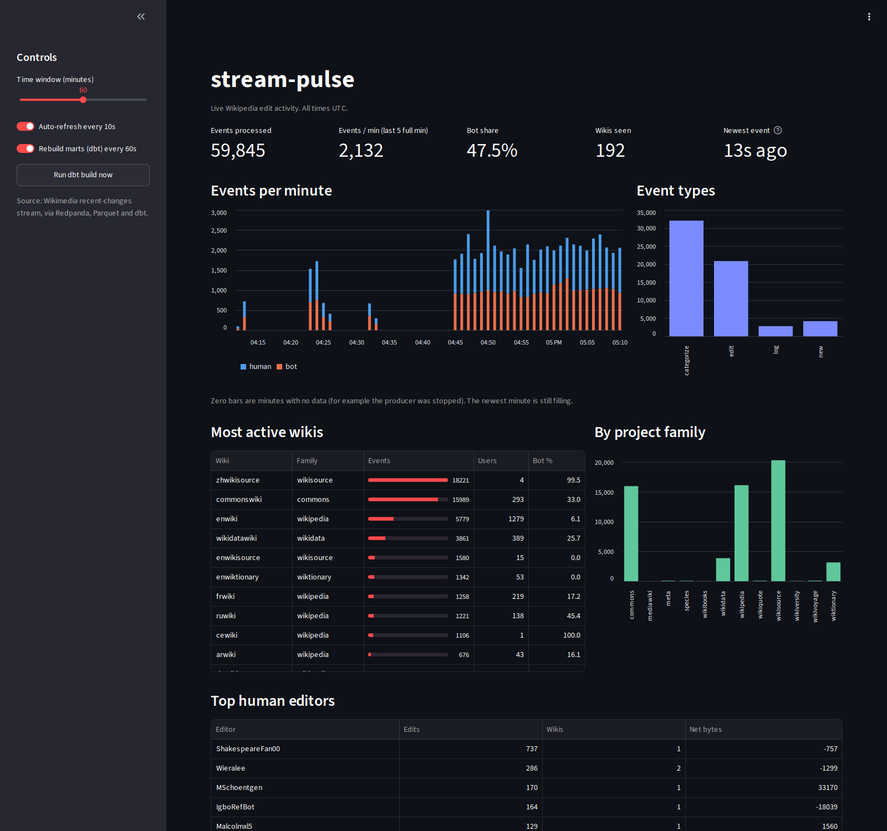
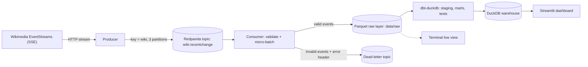

# stream-pulse


A real-time data pipeline on the live Wikipedia edit stream: Kafka-compatible streaming, a validated
raw layer with a dead-letter queue, dbt models with data tests, and a live dashboard. It runs locally
with one command and handles tens of events per second.



## Architecture



## Stack

| Concern | Tool |
|---|---|
| Streaming | Redpanda (Kafka API), `confluent-kafka` |
| Ingestion | Python, Server-Sent Events from Wikimedia |
| Raw layer | Append-only Parquet micro-batches |
| Transformation | dbt Core with the DuckDB adapter: 4 models, 17 data tests |
| Warehouse / query engine | DuckDB |
| Dashboard | Streamlit |
| Quality | pytest (15 tests), ruff, GitHub Actions CI |
| Infra | Docker Compose |

## How it works

1. **Producer** reads the Wikimedia recent-changes stream and publishes each event to Redpanda, keyed by wiki so a wiki's events stay ordered within a partition. It reconnects automatically if the stream drops.
2. **Consumer** validates every event, flattens it, and writes micro-batches of 200 events (or every 5 seconds) as Parquet files. Events that fail validation go to a dead-letter topic with the error in a message header.
3. **dbt** deduplicates and types the raw events (`stg_wiki_events`) and builds three marts: events per minute, a wiki leaderboard and top human editors. Tests check uniqueness, not-null columns, accepted event types and timestamps.
4. **Dashboard** reads the marts read-only, rebuilds them with dbt every 60 seconds, and refreshes every 10 seconds. It warns when no new events have arrived for 5 minutes.

## Design decisions and lessons

- **At-least-once delivery, effectively-once results.** The consumer commits Kafka offsets only after the Parquet file is safely written. A crash can therefore replay a batch, but never lose one. Duplicates are removed downstream on `event_id`, so replays do not change the numbers. This is covered by a test that writes the same batch twice.
- **Append-only Parquet instead of a shared database file.** The first version wrote straight into a DuckDB file. DuckDB allows one process to hold the file at a time, so the dashboard stalled whenever the consumer was writing, worst on a spinning disk. Switching the raw layer to Parquet files, written under a temporary name and then atomically renamed, removed every lock: readers never see a half-written file, and any number of readers can run at once.
- **A dead-letter queue instead of crashing or dropping.** Malformed events are kept with the reason they failed, so they can be inspected and replayed.
- **Tests that warn rather than break.** Wikimedia can introduce new event types at any time, so the accepted-values test is set to warn. The build stays green and the new type is flagged.
- **CI exercises the real models.** The workflow generates synthetic events with deliberate duplicates and one unknown event type, runs `dbt build` on them, and checks that the dedup logic and the warning both behave.

## A data-quality finding

Wikipedia's `bot` flag is not reliable. Accounts such as `IgboRefBot` perform automated edits but are not flagged, so they appear among the "top human editors". A naming heuristic (usernames ending in `Bot`) would be a cheap improvement, and is on the list below.

## Run it

Prerequisites: Docker Desktop and Python 3.11 or newer.

```bash
git clone https://github.com/buffandbearded/stream-pulse.git
cd stream-pulse
python -m venv .venv
source .venv/Scripts/activate        # Linux/macOS: source .venv/bin/activate
pip install -r requirements.txt

python scripts/run_all.py            # starts Redpanda, producer, consumer and dashboard
```

Open http://localhost:8501 (the dashboard) and http://localhost:8080 (Redpanda Console). Press `Ctrl+C` to stop everything.

Useful commands:

```bash
python -m src.live                                        # live terminal view of the stream
dbt build --project-dir dbt --profiles-dir dbt            # rebuild the marts and run the data tests
python scripts/show_marts.py                              # print the marts
pytest -q                                                 # unit tests
```

## Project layout

```
src/producer.py      Wikimedia stream to Redpanda
src/consumer.py      validation, dead-letter queue, Parquet raw layer
src/models.py        event validation and flattening
src/queries.py       lock-free reads and the terminal aggregations
dbt/                 staging model, marts, tests, macros
app/dashboard.py     Streamlit dashboard
scripts/             one-command launcher, sample data, helpers
infra/               Docker Compose for Redpanda and its console
tests/               pytest suite
```

## Limitations and next steps

- Treat usernames ending in `Bot` as bots in addition to the stream's flag.
- Make the dbt staging model incremental instead of rebuilding from all Parquet files.
- Compact the small Parquet files (roughly one every few seconds) into larger ones.
- Add a schema registry and contract checks on the incoming events.
- Add alerting on pipeline lag, not just a banner in the dashboard.
